## Hello ! 🤙

  

    I'm Luis, a developer from Denmark . 
  

  

    I work at <a href="https://www.juristic.io/" target="_blank">Juristic</a>, where I design the app end-to-end, wire up multi-cloud deployments across different cloud providers, and most importantly make sure everything just works.
  

  

    Outside of work you'll usually find me up a mountain, in the waves, or somewhere in a new city with my trusty fuji camera.
  

### Portfolio

  
  <b><a href="https://luissejer.dk">luissejer.dk</a></b>: My portfolio. The websites, web apps and automations I build for clients, and everything else I make. 
  <a href="https://luissejer.dk">Visit the website</a> · <a href="https://luissejer.dk/en">See it in English</a>

 

### Fun side projects

  
  <b><a href="https://github.com/Luis-Sejer/agent-orrery">Agent Orrery</a></b>: A live map of your Claude Code agents, and what's waiting on you. See every session and subagent, the repo each one is working in, and which ones need your reply. Free, open source, runs locally in Docker. 
  <a href="https://orrery.luissejer.dk">Visit the website</a> · <a href="https://github.com/Luis-Sejer/agent-orrery#get-started">Get started</a>

 

  
  <b><a href="https://github.com/Luis-Sejer/snicker-gif">Snicker</a></b>: GIF search in the Mac menu bar. Press ⌘⌥V, click a GIF, paste it anywhere, including Microsoft Teams. Free, open source, native SwiftUI. 
  <a href="https://luis-sejer.github.io/snicker-gif/">Try the live demo</a> · <a href="https://github.com/Luis-Sejer/snicker-gif/releases/latest">Download</a>

 

  
  <b><a href="https://github.com/Luis-Sejer/topside">Topside</a></b>: Eleven small Mac menu bar apps, one small problem each, like the week number, a mic mute for every call app and a second menu bar for the notch. Free, open source, native SwiftUI. 
  <a href="https://apps.luissejer.dk">Try them in your browser</a> · <a href="https://github.com/Luis-Sejer/topside/releases/latest">Download</a>

 

  
  <b>Coming soon</b>: Something is glowing under the hill. A small game I'm building after hours, and the door opens soon. 
  Nothing to click yet. Keep an eye on this spot.

 

### Tech I work with

shields.io didn't have real AWS or Azure logos, so that's a Saturn icon and a Star Trek badge up there standing in for two multi-billion dollar cloud providers. my ocd would not let me leave a badge logo-less, so a rogue planet and a Starfleet insignia it is.

 

